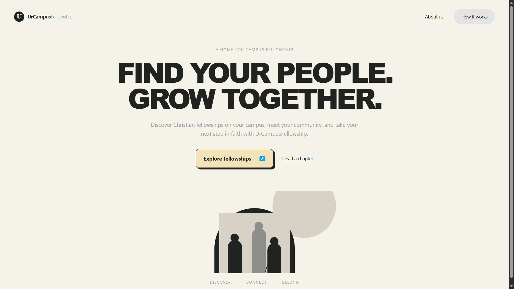

# UrCampusFellowship

**Find your fellowship. Join your community. All in one tap.**

UrCampusFellowship makes it easier for university students in Ghana to find and connect with their campus religious fellowships. Students can discover their fellowship and join the right WhatsApp group directly, eliminating the traditional hassle of being approached on campus to provide their names and contact details.

---


## 📖 About

UrCampusFellowship bridges the gap between university students seeking a faith community and campus fellowships seeking to connect with them.

It provides a central platform where students can discover fellowships by campus and denomination, access verified meeting times and locations, and connect directly through the appropriate WhatsApp groups.

## Why UrCampusFellowship?

Starting university can make finding a faith community difficult, especially for freshers who may not know which fellowships exist on campus or where to find them.

Traditionally, fellowships rely on physical outreach, flyers, and word of mouth to reach new students. This often involves walking around campus to collect names and phone numbers, while essential information such as meeting times, venues, and contact details remains difficult to access.

UrCampusFellowship simplifies this process by bringing fellowship information and student connections into one accessible platform.

## How UrCampusFellowship Helps

UrCampusFellowship addresses these challenges by providing tailored tools for everyone involved in the campus fellowship ecosystem:

- **For Students:** Discover fellowships by campus and denomination, explore meeting details, and connect directly through the appropriate WhatsApp groups.

- **For Fellowship Leaders:** Manage fellowship chapter information, view registered members, and maintain accurate membership records.

- **For Administrators:** Manage the fellowship directory, register new fellowships and campuses, and oversee the overall operation of the platform.

---

## 🎯 How It Works

### For Students

1. **Discover**: Browse fellowships by campus or search for your denomination
2. **Connect**: View meeting details, times, locations, and leadership information
3. **Join**: Register in under a minute and get instant WhatsApp group access
4. **Belong**: Manage your profile and fellowship membership anytime

### For Fellowship Leaders

1. **Set Up**: Add meeting day, time, location, and WhatsApp group link
2. **Manage**: View your chapter's roster with member details (name, email, phone, program, hall, level)
3. **Maintain**: Flag members for follow-up or remove them when needed
4. **Grow**: Your chapter becomes visible to students browsing fellowships on your campus

### For System Administrators

1. **Organize**: Add new denominations, campuses, and fellowships to the directory
2. **Assign**: Create chapter head accounts and manage fellowship leadership
3. **Monitor**: View platform-wide statistics without accessing individual student data

---

## ✨ Key Features

- 📍 **Campus-aware** — Multi-campus support with campus-specific chapter listings
- ⚡ **Instant access** — No approval process; students join WhatsApp groups immediately
- 🔒 **Privacy by design** — Fellowship leaders only see their own members
- 🚫 **One fellowship rule** — Students can only be in one fellowship at a time
- 🎨 **Beautiful UI** — Clean, accessible design with consistent styling
- 📱 **Fully responsive** — Works seamlessly on desktop, tablet, and mobile
- 🔐 **Role-based access** — Different dashboards for students, chapter heads, and admins
- 📋 **Complete roster management** — Search, filter, and manage members efficiently
- 📄 **Legal compliance** — Terms of Service and Privacy Policy pages included

---

## 🛠 Tech Stack

### Frontend
- **Framework**: [Next.js 16.3](https://nextjs.org/) (App Router)
- **Language**: TypeScript 5.7
- **Styling**: Tailwind CSS 4.3 with custom design system
- **UI Components**: 
  - shadcn/ui 4.11
  - Base UI (Headless components)
  - Radix UI primitives
  - Lucide React icons
- **Utilities**: 
  - clsx & tailwind-merge for conditional styling
  - class-variance-authority for component variants
- **Analytics**: Vercel Analytics

### Backend (Planned)
- **Database**: Supabase (PostgreSQL)
- **Authentication**: Supabase Auth with email verification
- **Real-time**: Supabase Realtime subscriptions
- **Storage**: Supabase Storage for assets
- **API**: Next.js API Routes / Server Actions

### Infrastructure
- **Hosting**: Vercel
- **Package Manager**: pnpm 12.3
- **Version Control**: Git

---

## 📁 Project Structure

```
urcampusfellowship/
├── docs/                          # Documentation
│   ├── Requirements.docx          # Project requirements
│   ├── System_Design.docx         # System architecture
│   └── USER-STORIES.md            # User stories and use cases
├── screenshots/                   # Application screenshots
├── src/                           # Source code
│   ├── app/                       # Next.js App Router pages
│   │   ├── about/                 # About us page
│   │   ├── admin/                 # Admin dashboard
│   │   │   ├── chapter/           # Chapter management
│   │   │   │   └── new/           # Create new chapter
│   │   │   ├── denominations/     # Denomination management
│   │   │   │   └── new/           # Create new denomination
│   │   │   └── page.tsx           # Admin overview
│   │   ├── auth/                  # Authentication
│   │   │   ├── login/             # Chapter head login
│   │   │   └── signup/            # Student signup
│   │   ├── for-leaders/           # Leaders information page
│   │   ├── heads/                 # Chapter head dashboard
│   │   │   ├── roster/            # Member roster management
│   │   │   ├── setup/             # Chapter setup
│   │   │   └── page.tsx           # Head overview
│   │   ├── how-it-works/          # How it works page
│   │   ├── privacy/               # Privacy policy
│   │   ├── student/               # Student pages
│   │   │   ├── chapter/           # Chapter details
│   │   │   ├── register/          # Registration flow
│   │   │   ├── success/           # Success confirmation
│   │   │   └── page.tsx           # Fellowship directory
│   │   ├── terms/                 # Terms of service
│   │   ├── globals.css            # Global styles & design system
│   │   ├── layout.tsx             # Root layout
│   │   └── page.tsx               # Landing page
│   ├── components/                # React components
│   │   ├── admin/                 # Admin-specific components
│   │   │   └── admin-overview.tsx
│   │   ├── common/                # Shared components
│   │   │   ├── dashboard-shell.tsx  # Dashboard layout wrapper
│   │   │   ├── site-footer.tsx      # Site footer with legal links
│   │   │   └── site-header.tsx      # Site header & navigation
│   │   ├── heads/                 # Chapter head components
│   │   │   └── head-overview.tsx
│   │   ├── student/               # Student-specific components
│   │   │   ├── chapter-detail.tsx   # Chapter detail view
│   │   │   ├── home-page.tsx        # Student home
│   │   │   ├── register-page.tsx    # Registration form
│   │   │   ├── student-page.tsx     # Student profile
│   │   │   └── success-page.tsx     # Success screen
│   │   └── ui/                    # Base UI components
│   │       └── button.tsx         # Button component
│   ├── data/                      # Mock data & types
│   ├── lib/                       # Utilities and helpers
│   ├── components.json            # shadcn/ui configuration
│   ├── next.config.mjs            # Next.js configuration
│   ├── package.json               # Dependencies
│   ├── postcss.config.mjs         # PostCSS configuration
│   └── tsconfig.json              # TypeScript configuration
├── CODE_OF_CONDUCT.md            # Community guidelines
├── CONTRIBUTING.md               # Contribution guidelines
├── LICENSE                       # MIT License
└── README.md                     # This file
```

---

## 🚀 Getting Started

### Prerequisites

- **Node.js** 18.18 or later
- **pnpm** 12.3 or later (or npm/yarn)
- **Git** for version control

### Installation

```bash
# Clone the repository
git clone https://github.com/mmabiaa/urcampusfellowship.git

# Navigate to the project directory
cd urcampusfellowship/src

# Install dependencies
pnpm install
# or
npm install

# Run the development server
pnpm dev
# or
npm run dev
```

Open [http://localhost:3000](http://localhost:3000) in your browser to view the application.

### Available Scripts

```bash
pnpm dev        # Start development server on http://localhost:3000
pnpm build      # Build for production
pnpm start      # Start production server
```

---

## 🎨 Design System

UrCampusFellowship features a custom design system with:

### Color Palette
- **Ink** (#20231f) - Primary text and borders
- **Paper** (#f5f2ea) - Background
- **Cream** (#fffdf7) - Card backgrounds
- **Moss** (#3f4a36) - Primary actions
- **Sage** (#dfe5d7) - Accent backgrounds
- **Clay** (#a56f59) - Secondary accents
- **Gold** (#e8c878) - Highlights
- **Butter** (#f2e3ba) - CTA backgrounds

### Typography
- **Headings**: Georgia (serif) for warmth and readability
- **Body**: System font stack for optimal performance
- Letter spacing optimized for readability (-0.01em to -0.04em)

### Components
- Custom buttons with shadow effects and hover states
- Cards with subtle shadows and border styling
- Responsive navigation with mobile hamburger menu
- Accessible form inputs with focus states
- Status badges for chapter states (active, draft, coming soon)

---

## 📄 Page Overview

### Public Pages
- **Landing** (`/`) - Hero section with platform overview
- **About** (`/about`) - Mission, vision, and platform benefits
- **How It Works** (`/how-it-works`) - Step-by-step guide for all users
- **For Leaders** (`/for-leaders`) - Information for chapter heads
- **Terms** (`/terms`) - Terms of Service
- **Privacy** (`/privacy`) - Privacy Policy

### Student Flow
- **Directory** (`/student`) - Browse fellowships by campus
- **Chapter Details** (`/student/chapter`) - View chapter information
- **Register** (`/student/register`) - Join a fellowship
- **Success** (`/student/success`) - Registration confirmation

### Chapter Head Dashboard
- **Overview** (`/heads`) - Dashboard with statistics
- **Setup** (`/heads/setup`) - Configure chapter details
- **Roster** (`/heads/roster`) - Manage members

### Admin Dashboard
- **Overview** (`/admin`) - Platform-wide statistics
- **Chapters** (`/admin/chapter`) - Manage all chapters
- **Denominations** (`/admin/denominations`) - Manage denominations

---

## 🔐 User Roles

### Student
- Browse fellowship directory
- View chapter details
- Register with one fellowship
- Manage profile and membership
- Access WhatsApp groups

### Chapter Head
- Set up and edit chapter information
- View registered members
- Manage roster (flag/remove members)
- Access only their own chapter data

### System Administrator
- Add/edit denominations
- Add/edit campuses
- Create chapter head accounts
- View platform-wide statistics
- No access to individual student data

---

## 🚧 Project Status

- ✅ **Requirements** - Complete
- ✅ **System Design** - Complete
- ✅ **UI/UX Design** - Complete
- ✅ **Frontend Implementation** - Complete
- ✅ **Component Library** - Complete
- ✅ **Public Pages** - Complete (About, How It Works, For Leaders, Terms, Privacy)
- ✅ **Backend Integration** - Complete
- ✅ **Authentication** - Complete
- ✅ **Database Schema** - Complete
- ✅ **API Development** - Complete
- ✅ **Testing** - Complete
- ✅ **Deployment** - Complete

---

## 🤝 Contributing

We welcome contributions from developers, designers, and community members! Here's how you can help:

### Ways to Contribute
- 🐛 Report bugs and issues
- 💡 Suggest new features
- 📝 Improve documentation
- 🎨 Enhance UI/UX
- 🔧 Submit pull requests

Please read our [Contributing Guide](CONTRIBUTING.md) and [Code of Conduct](CODE_OF_CONDUCT.md) before contributing.

### Development Workflow
1. Fork the repository
2. Create a feature branch (`git checkout -b feature/amazing-feature`)
3. Commit your changes (`git commit -m 'Add amazing feature'`)
4. Push to the branch (`git push origin feature/amazing-feature`)
5. Open a Pull Request

---

## 🎓 For Students & Fellowship Leaders

### Students
If you're part of a fellowship on campus and want to be one of the first to join when we launch, reach out! We're looking for early adopters to test the platform and provide feedback.

### Fellowship Leaders
Interested in managing your chapter through UrCampusFellowship? We'd love to hear from you. Get in touch to learn more about how the platform can help you reach and manage your community.

---

## 📞 Contact & Support

For questions, suggestions, or partnership inquiries:

- **Email**: [mmaabiaa@gmail.com](mailto:mmaabiaa@gmail.com)
- **GitHub**: [@mmabiaa](https://github.com/mmabiaa)
- **Issues**: [GitHub Issues](https://github.com/mmabiaa/urcampusfellowship/issues)

---

## 📜 License

This project is licensed under the MIT License - see the [LICENSE](LICENSE) file for details.

---

## 🙏 Acknowledgments

Built with ❤️ for campus communities in Ghana.

Special thanks to:
- All fellowship leaders working tirelessly to build campus communities
- Students who provided feedback and insights
- Open source contributors and the Next.js community
- Everyone helping make fellowship discovery easier

---

## 🌟 Future Plans

- Email verification system
- Real-time roster updates
- Push notifications for announcements
- Mobile app (React Native)
- Multi-university expansion
- Analytics dashboard for leaders
- Event management features
- Resource sharing capabilities

---

**Made with purpose for campus ministry in Ghana.**

© 2026 UrCampusFellowship. All rights reserved.
